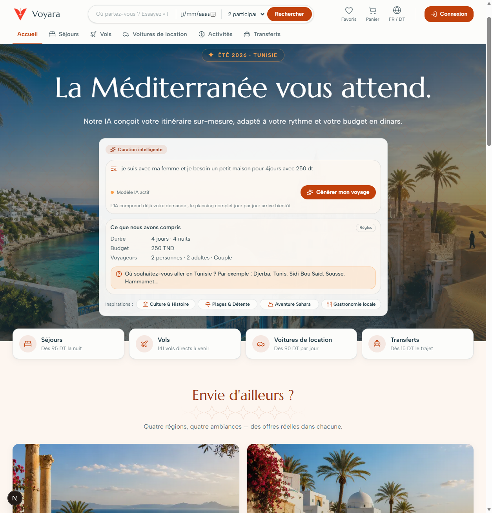
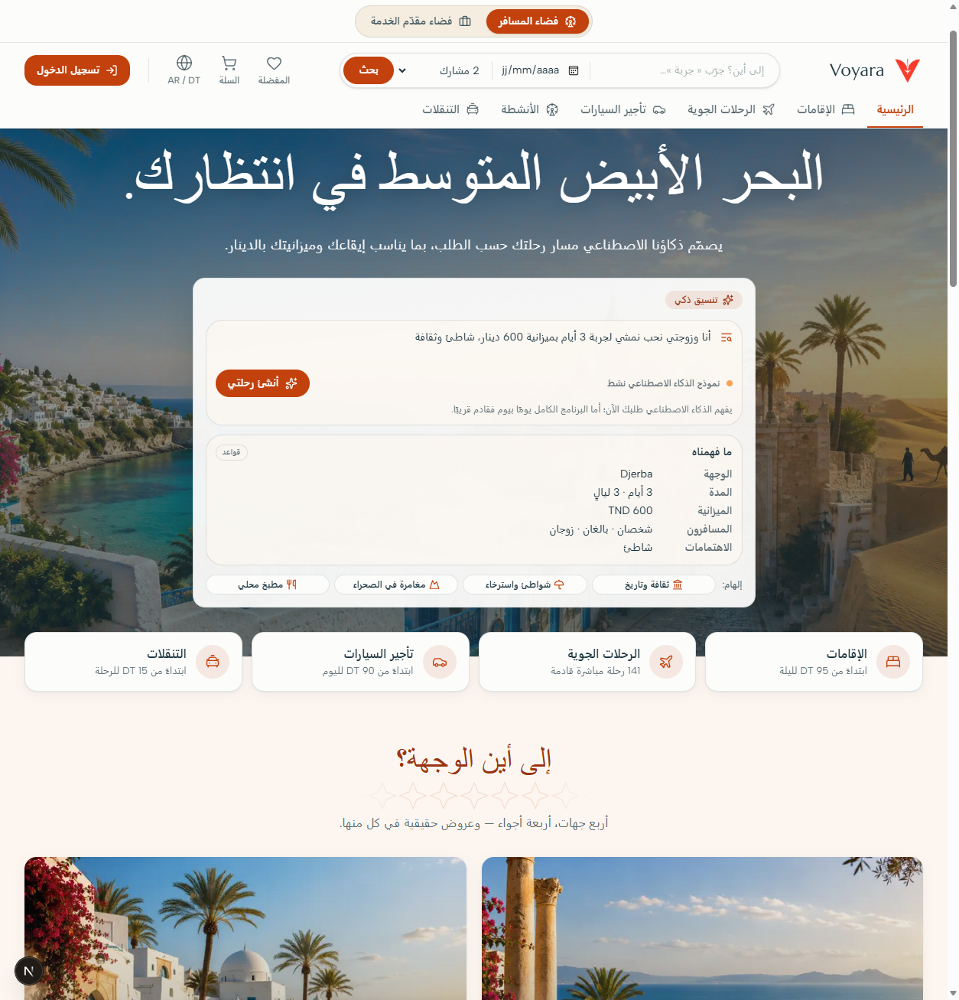

# Étape 04 — Accueil : « Curation intelligente » branchée sur le module NLU (sous-tâche)

> Date : 2026-11-10 · Branche : ia/etape-04-accueil (depuis `main`, `b060571`) · Module(s) : 1 (NLU), site client

## 1. Objectif

Permettre de tester le module 1 depuis le site. La zone « Curation intelligente » de l'accueil envoie
la demande à `POST /api/ai/comprendre` via le gateway, puis affiche ce qui a été compris. C'est une
version minimale : l'interface complète « Planifier mon voyage » (chat, planning, carte) reste prévue
à l'étape 9.

## 2. Réalisé

| Fichier | Créé / modifié | Rôle (une ligne) |
|---|---|---|
| `frontend/packages/api/src/endpoints.ts` | modifié | `endpoints.ai.comprendre = "/api/ai/comprendre"` |
| `frontend/apps/client/src/features/ai/comprendre.ts` | créé | Types de la réponse, `comprendreApi` (délai 35 s), `useComprendre` (mutation), classement des erreurs |
| `frontend/apps/client/src/components/home/AiUnderstanding.tsx` | créé | Carte « Ce que nous avons compris » (champs non vides, question mise en évidence, badge de méthode) |
| `frontend/apps/client/src/components/home/AiTripPlanner.tsx` | modifié | Envoi réel, état de chargement, pas de double envoi, erreurs, note honnête ; « Inspirations » inchangées |
| `frontend/packages/i18n/src/locales/{fr,en,ar}/common.json` | modifiés | `soon` remplacé par `note` ; `loading`, `errors.*`, `understood.*` ; pluriels arabes (duel, 3-10, 11-99) |
| `frontend/apps/client/src/components/home/AiTripPlanner.test.tsx` | créé | 8 tests vitest (jsdom, appel simulé) + parité des clés fr / en / ar |
| `docs/ia/rapports/img/etape-04-accueil-{fr,ar}.png` | créés | Captures réelles (Edge headless) |

## 3. Choix techniques

**Client HTTP.** L'appel passe par le client axios partagé (`@voyara/api`).
- *Jeton* : il est ajouté seulement si l'utilisateur est connecté (intercepteur existant), ce qui
  correspond à l'auth facultative de la route. Aucun code d'auth n'a été écrit.
- *Délai de 35 s, pour cet appel seulement* :
  - le délai global d'axios (20 s) couperait la route, qui attend le LLM jusqu'à 25 s ;
  - le proxy Next (`proxy-request.js`, Next 16) et le gateway coupent tous deux à 30 s ;
  - 35 s laisse donc toujours la main au serveur. Le délai global n'est pas modifié.

**Mutation sans nouvel essai.** Le modèle `useMutation` est celui du projet (`features/favorites`). Une
mutation ne réessaie pas par défaut. De plus, `submit` refuse un envoi si le texte est vide ou si un
appel est en cours, et le bouton est désactivé (`aria-busy`). On ne peut donc pas déclencher deux
appels au LLM.

**Erreurs.**

| Code | Cause | Message affiché |
|---|---|---|
| 429 | trop de demandes (20 par minute) | « trop de demandes » |
| 503 | service `ai` arrêté, ou délai dépassé dans le gateway | « service indisponible » |
| 500 | proxy Next sans gateway | « service indisponible » |
| 502, 504 | gateway | « service indisponible » |
| 0 | réseau coupé ou délai axios dépassé | « service indisponible » |
| autre | — | « demande non analysée » |

Le message s'affiche dans un `role="alert"`, la page ne plante pas et la saisie reste utilisable.

**Affichage.**
- Les champs vides ne sont pas rendus.
- Les thèmes, le type de voyage et les besoins de transport (codes de l'API) sont traduits en fr / en
  / ar. Les activités, la question et les villes restent telles que l'API les renvoie.
- La question arrive dans la langue de la demande, comme le fait déjà le module 1.
- Le badge de méthode est discret : « IA + règles » pour `hybride`, « Règles » pour `regles`.

**RTL.** Il est géré globalement par `@voyara/i18n` (`<html dir>`). Le composant n'utilise que des
classes logiques (`text-start`, `gap`).

**Pluriels arabes.** i18next sélectionne `_two`, `_few` et `_many` en arabe. Sans ces formes, « 4
jours » aurait été affiché au singulier ; elles ont été ajoutées.

## 4. Vérification

**Tests et contrôle de types** :

```text
PS> cd frontend; npm run test
 Test Files  2 passed (2)
      Tests  12 passed (12)

PS> cd frontend; npm run typecheck
> @voyara/client@0.0.0 typecheck > tsc --noEmit
> @voyara/admin@0.0.0 typecheck > tsc --noEmit        (aucune erreur)
```

Les 8 nouveaux tests de `AiTripPlanner.test.tsx` couvrent :
- **le succès** : bouton désactivé et « Analyse de votre demande… » pendant l'appel, un seul appel
  malgré un second clic, carte complète, champs vides absents ;
- **la question de clarification** : encadré visible, badge « Règles » ;
- **les erreurs 429, 503, 0 et 422** : message clair, bouton réactivé ;
- **un texte vide** : aucun envoi ;
- **la parité des clés** de `home.aiPlanner` en fr / en / ar.

Pendant l'écriture des tests, un défaut du test lui-même (pas du composant) a fait échouer les 4 cas
d'erreur. `beforeEach(() => post.mockReset())` renvoyait le mock, que vitest appelle comme fonction
de nettoyage après chaque test : le mock rejetait alors l'erreur simulée de ce test. Corrigé par des
accolades.

**Vérification réelle dans le navigateur.**
- Les services avaient été lancés par l'étudiant (`scripts\dev.ps1` + client sur :5173). J'ai démarré
  Ollama et fait un appel de préchauffage (295 s : le modèle était rechargé après le redémarrage du
  conteneur).
- Un script Node pilote Edge headless par le protocole de débogage, avec le `WebSocket` natif de
  Node 24 et aucune dépendance ajoutée. Il saisit le texte, clique, attend la carte et fait une
  capture.

Phrase demandée, en français :

```text
pendant l'appel : Analyse de votre demande… | disabled=true
réponse en 26.2 s
Ce que nous avons compris · Règles
Durée 4 jours · 4 nuits · Budget 250 TND · Voyageurs 2 personnes · 2 adultes · Couple
Où souhaitez-vous aller en Tunisie ? Par exemple : Djerba, Tunis, Sidi Bou Saïd, Sousse, Hammamet…
html dir = ltr | lang = fr
```

Le résultat est conforme à l'attendu : couple, 2 adultes, 4 jours, 250 TND, question sur la
destination.



Interface en arabe, avec la demande « أنا وزوجتي نحب نمشي لجربة 3 أيام بميزانية 600 دينار، شاطئ وثقافة » :

```text
pendant l'appel : جارٍ تحليل طلبك… | disabled=true
réponse en 25.4 s
ما فهمناه · قواعد
الوجهة Djerba · المدة 3 أيام · 3 ليالٍ · الميزانية 600 TND · المسافرون شخصان · بالغان · زوجان · الاهتمامات شاطئ
html dir = rtl | lang = ar
```

Le RTL est correct : en-tête, carte et inspirations sont en miroir, et les pluriels s'accordent
(duel, puis 3 à 10).



## 5. Métriques

Non applicable : aucune évaluation de modèle. Les seules mesures sont les temps de réponse réels
dans le navigateur, sur ce poste : 26,2 s et 25,4 s.

## 6. Limites, dette technique, risques

- **Les deux appels réels ont fini sur les règles** (badge « Règles »). Ollama a dépassé le délai de
  25 s de la route, même après préchauffage. Le résultat attendu vient donc des règles. C'est le
  risque de démo déjà noté dans le rapport NLU (17 % des appels > 25 s sur le test). Il est à traiter
  à l'étape 9 : `keep_alive`, préchauffage au démarrage, streaming ou délai propre à `/api/ai`.
- **« ثقافة » (culture) n'est pas reconnu** dans la demande arabe : seul « شاطئ » (plage) l'est. C'est
  une lacune du vocabulaire des règles en arabe, visible parce que le LLM n'a pas répondu à temps.
  Elle n'est pas corrigée ici : la consigne de l'étape 4 interdit de retoucher les règles.
- **Noms de villes non traduits** : « Djerba » s'affiche en caractères latins dans l'interface arabe.
  Le module 1 renvoie le nom canonique du catalogue.
- **Erreurs vérifiées par les tests seulement** : les cas 429, 503 et réseau n'ont pas été reproduits
  dans le navigateur. Il aurait fallu arrêter des services lancés par l'étudiant.
- **Attente** : l'attente de 15 à 26 s n'affiche qu'un indicateur de chargement, sans progression.
- **Rien de conservé** : la réponse n'est pas gardée ; un rechargement de la page la perd.

## 7. À vérifier par moi

1. `docker compose --profile ollama up -d ollama`, `.\scripts\dev.ps1`, `cd frontend; npm run dev`.
2. Ouvrir http://localhost:5173. Saisir « je suis avec ma femme et je besoin un petit maison pour
   4jours avec 250 dt », puis cliquer « Générer mon voyage ».
   - Attendu : bouton désactivé et « Analyse de votre demande… », puis la carte (4 jours, 250 TND,
     2 adultes, Couple) et la question sur la destination.
3. Recliquer plusieurs fois pendant l'analyse : un seul appel doit partir. Le vérifier dans l'onglet
   Réseau du navigateur.
4. Passer en arabe avec le sélecteur de langue : carte et libellés à droite, pluriels corrects.
5. Arrêter le service `ai` (fermer sa fenêtre uvicorn) puis renvoyer : message « service
   indisponible », la page reste utilisable.
6. `cd frontend; npm run test; npm run typecheck`.

## 8. Étape suivante recommandée

**Étape 5** : recherche sémantique, RAG et recherche transport. L'interface « Planifier mon voyage »
(étape 9) remplacera cette carte par le planning complet. Avant la démo, il faut régler la latence
d'Ollama (`keep_alive`, préchauffage, streaming).
