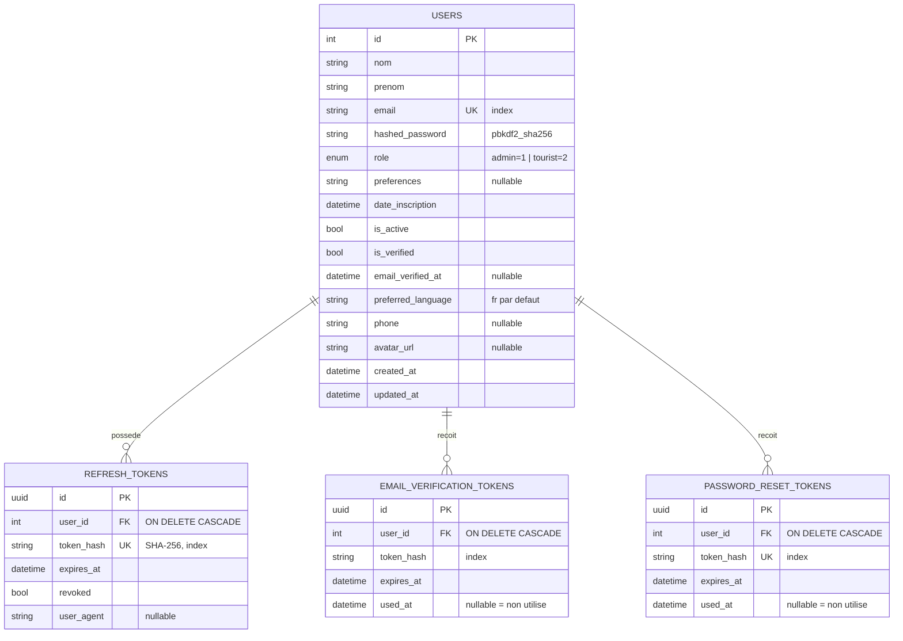
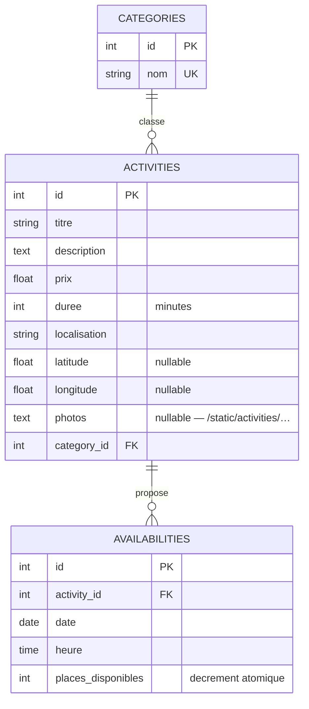
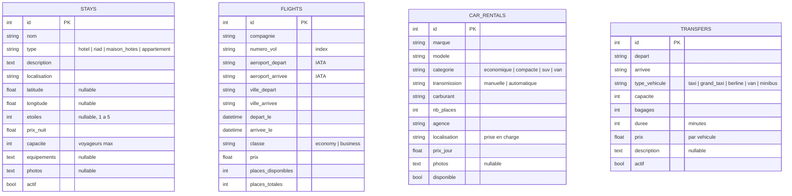
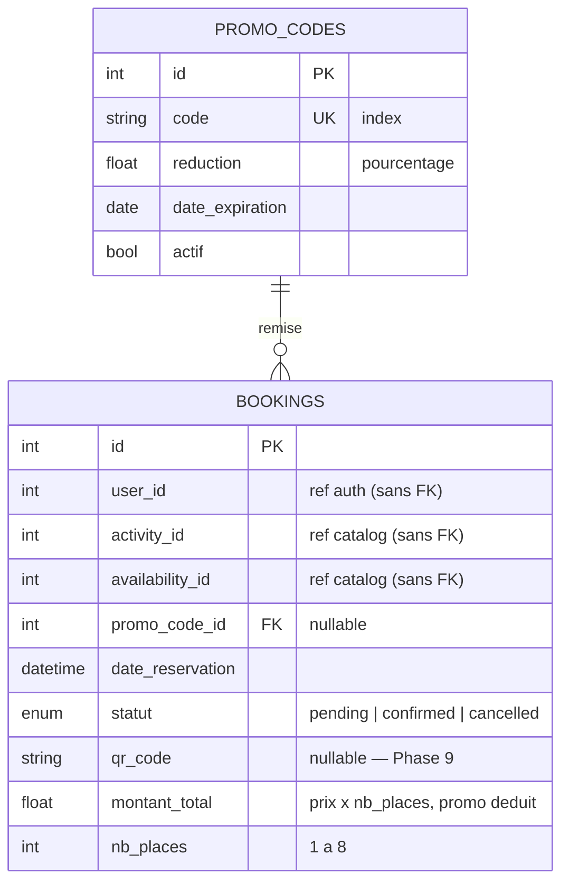
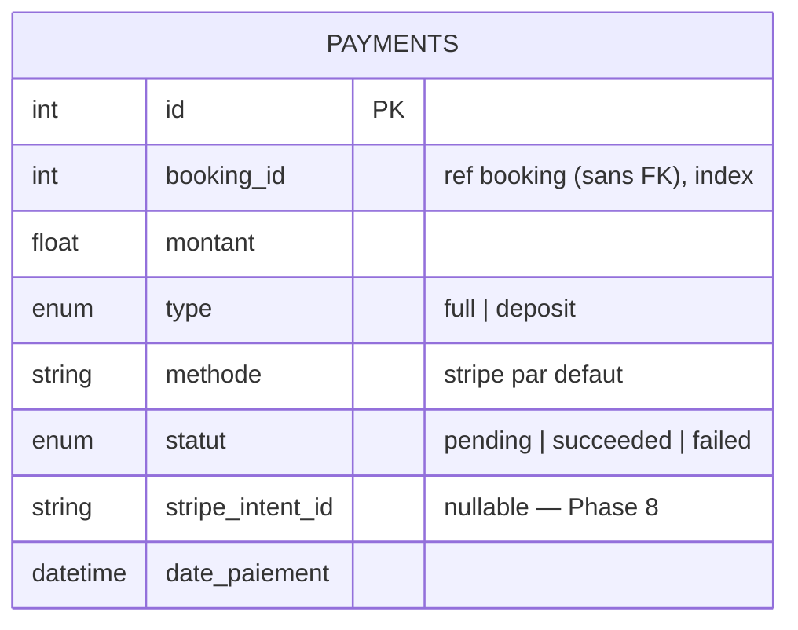
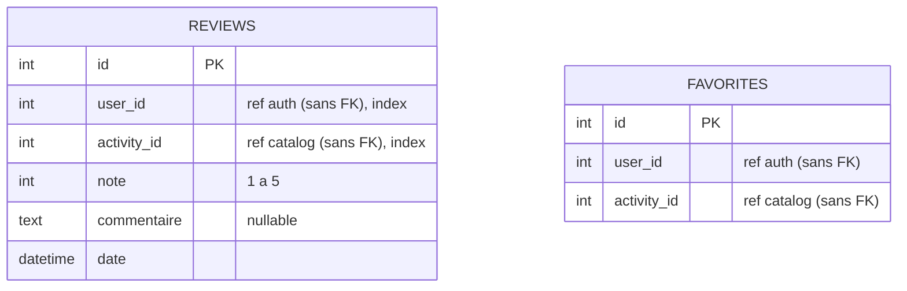
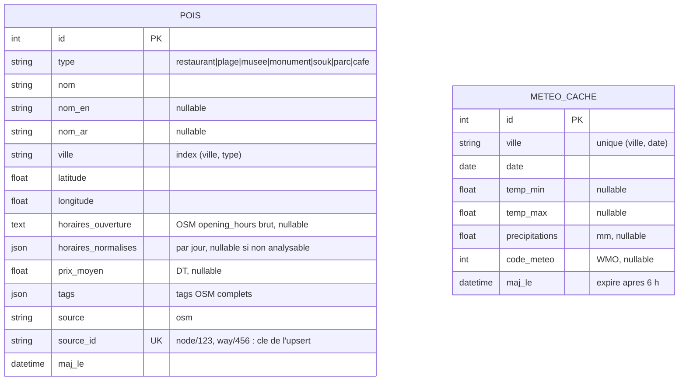
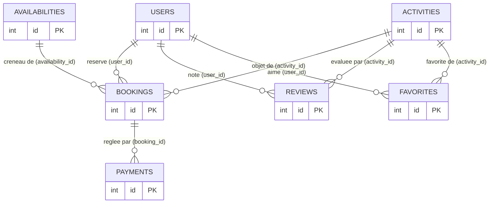

# Modèle de données Voyara (MCD)

> Généré depuis les modèles SQLAlchemy réels (14/08/2026). Architecture
> **database-per-service** : chaque diagramme correspond à une base distincte ;
> les références inter-services (pointillés du dernier schéma) sont de simples
> entiers **sans clé étrangère**, validés par appel API (voir
> [architecture.md — ADR-002](architecture.md#adr-002--une-base-postgresql-par-service)).

## 1. Base `voyara` — auth-service

## 2. Base `voyara_catalog` — catalog-service

### Offres de voyage (tables préparées, API à venir)

Onglets Séjours, Vols, Voitures de location et Transferts de la navbar. Tables
indépendantes, sans relation entre elles ni avec les activités.

## 3. Base `voyara_booking` — booking-service

## 4. Base `voyara_payment` — payment-service

## 5. Base `voyara_review` — review-service

> `FAVORITES` : contrainte d'unicité `(user_id, activity_id)` — un favori par
> utilisateur et par activité.

## 5 bis. Base `voyara_ai` — moteur IA (conteneur `postgres-ai`, port 5435)

> Ajoutée à l'étape 1 du moteur IA (13/10/2026, [ADR-007](architecture.md#adr-007--microservice-ai-dédié-pgvector-et-llm-hybride)).
> Modèles : `services/ai/app/models.py`. Aucune référence vers les autres bases : une activité
> du catalogue est rapprochée d'un POI par ses coordonnées GPS, jamais par clé.

## 6. Vue d'ensemble — relations inter-services (logiques, sans FK)

**Règles de cohérence applicative** (remplacent les FK inter-services) :
- La création d'une réservation **vérifie** l'activité et le créneau via l'API du
  catalog-service (saga, [architecture.md §4.5](architecture.md#45-saga-de-réservation-multi-voyageurs)).
- La suppression d'une activité est **refusée** s'il existe des réservations
  (garde inter-services 409).
- Le dépôt d'un avis est **refusé** si l'utilisateur n'a pas de réservation non
  annulée de l'activité (`has-booked`).
- La suppression de compte **anonymise** l'utilisateur au lieu de le supprimer :
  les `user_id` référencés ailleurs restent valides.
